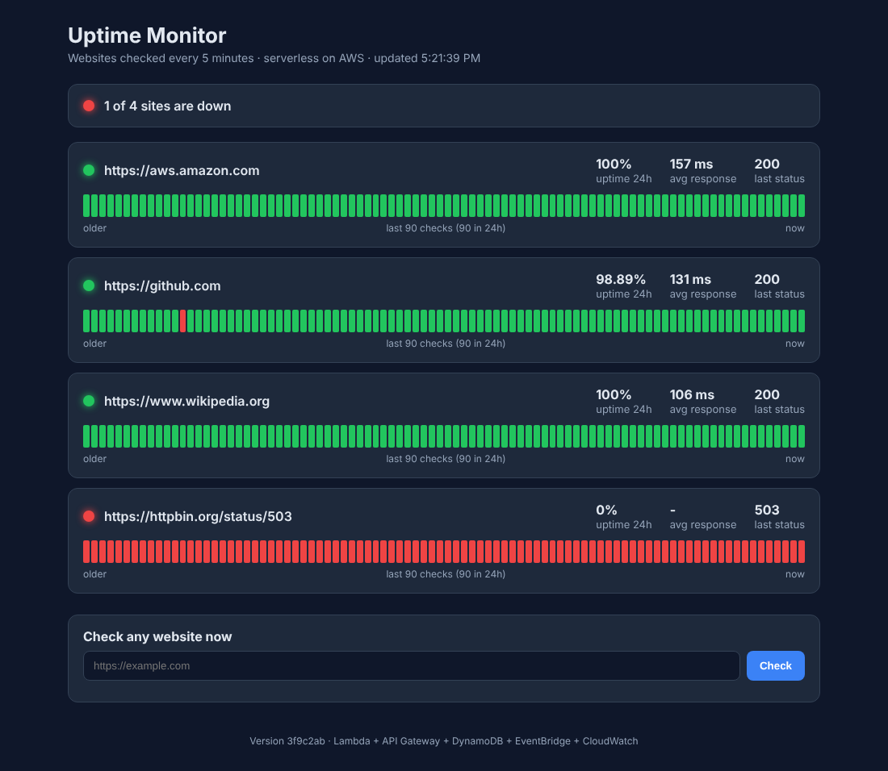
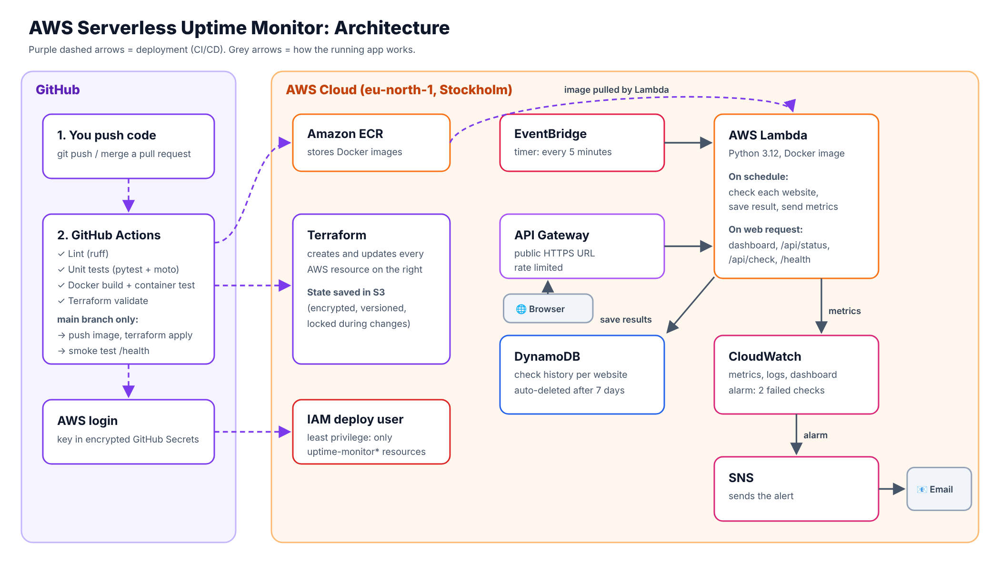
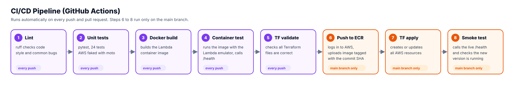
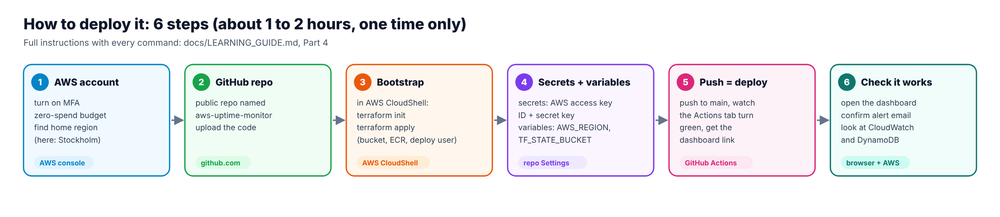

# AWS Serverless Uptime Monitor

[](https://github.com/Gautamhub1/UPTIME---Monitoring/actions/workflows/pipeline.yml)


> **A website monitoring service that runs on AWS.** Every 5 minutes it checks a list of websites, records whether each one is up and how fast it responds, shows the results on a live dashboard, and **sends an email alert when a website goes down**.
>
> Built with **Python, Docker, Terraform and GitHub Actions** on **AWS Lambda, API Gateway, DynamoDB, EventBridge, CloudWatch and SNS**. Every code change is tested and deployed automatically.

**🔗 Live dashboard:** **https://6co3e8qh6k.execute-api.eu-north-1.amazonaws.com/**

**Health check:** [/health](https://6co3e8qh6k.execute-api.eu-north-1.amazonaws.com/health) · **Status API:** [/api/status](https://6co3e8qh6k.execute-api.eu-north-1.amazonaws.com/api/status)

---

## Contents
1. [What problem does it solve?](#1-what-problem-does-it-solve)
2. [What it looks like](#2-what-it-looks-like)
3. [How it works (simple explanation)](#3-how-it-works-simple-explanation)
4. [Architecture](#4-architecture)
5. [Technologies used and why](#5-technologies-used-and-why)
6. [CI/CD pipeline](#6-cicd-pipeline)
7. [How to deploy it yourself (step by step)](#7-how-to-deploy-it-yourself-step-by-step)
8. [API endpoints](#8-api-endpoints)
9. [Project structure](#9-project-structure)
10. [Security](#10-security)
11. [Cost](#11-cost)
12. [Delete everything](#12-delete-everything)
13. [Future improvements](#13-future-improvements)

---

## 1. What problem does it solve?

When a website or an API stops working, a company loses customers and money every minute. The team needs to know **immediately**, ideally **before** the customers notice.

This project:

| Need | What the project does |
|---|---|
| Know if a website is working | Checks each website every 5 minutes (HTTP status code) |
| Know if it is slow | Measures the response time in milliseconds |
| See the history | Stores 7 days of results and shows **uptime %** for the last 24 hours |
| Be told when something breaks | **Emails an alert** when a site fails 2 checks in a row, and again when it recovers |
| Check any site on demand | A "Check any website now" box and an API endpoint |

Commercial tools such as UptimeRobot or Pingdom do the same job. This is a small version built from scratch on AWS.

---

## 2. What it looks like

### The live dashboard
Green = website is up, red = down. Each small bar is one check (newest on the right).



*Preview rendered with sample data. Replace it with a screenshot of your live deployment.*

<!--
After deploying, add your own screenshots here, for example:
### CloudWatch dashboard

### Alert email

### Green pipeline

-->

### Real results from the live deployment
Measured by this project in AWS `eu-north-1` (Stockholm). These are the first 24 hours of monitoring, read from `/api/status` on 21 November 2026.

| Website | Checks (24 h) | Uptime | Avg. response time | What it shows |
|---|---|---|---|---|
| aws.amazon.com | 288 | **100%** | 187.4 ms | Healthy |
| github.com | 288 | **100%** | 35.4 ms | Healthy, fastest |
| www.wikipedia.org | 288 | **99.65%** | 81.9 ms | **A real short outage was detected** |
| httpbin.org/status/503 | 288 | **0%** | – | Test site that fails on purpose (HTTP 503) to prove the alerting works |

- **288 checks per site per day** = one every 5 minutes, fully automatic.
- The CI/CD pipeline deploys a new version in about **1.5 minutes** (tests + deploy).
- AWS cost: within the free tier.

---

## 3. How it works (simple explanation)

**Every 5 minutes (automatic):**
1. ⏰ **EventBridge**, a timer inside AWS, wakes up the program.
2. 🐍 **AWS Lambda** runs the Python code. The code is packaged as a **Docker** image.
3. 🌐 The code visits each website and notes: *up or down? status code? how many milliseconds?*
4. 💾 It saves each result in **DynamoDB**, a database. Old results are deleted automatically after 7 days.
5. 📈 It sends the numbers to **CloudWatch**, AWS's monitoring service.
6. 🚨 If a website fails **2 checks in a row**, a CloudWatch **alarm** fires and **SNS** sends an **email**.

**When someone opens the dashboard:**
1. The browser calls the public HTTPS address of **API Gateway**.
2. API Gateway passes the request to the same **Lambda** function.
3. Lambda reads the last 24 hours from DynamoDB and returns the web page and the data.

**When the developer changes the code:**
1. The code is pushed to **GitHub**.
2. **GitHub Actions** tests it, builds the Docker image and tests the image.
3. If everything passes, it uploads the image to **Amazon ECR** and runs **Terraform**, which updates AWS automatically.
4. It finally opens the live website to check that the new version works.

---

## 4. Architecture



---

## 5. Technologies used and why

| Technology | Role in this project | Why this choice |
|---|---|---|
| **AWS Lambda** | Runs the Python code | No server to manage; pay only when it runs (almost free here) |
| **Docker + Amazon ECR** | Packages the code as a container image and stores it | The exact image tested in CI is the one that runs in AWS |
| **Amazon API Gateway** (HTTP API) | Public HTTPS address for the dashboard and API | Managed HTTPS, rate limiting, no web server needed |
| **Amazon EventBridge** | Runs the checks every 5 minutes | Managed scheduler, like a cloud "cron" |
| **Amazon DynamoDB** | Stores the check history | Fast, serverless database; **TTL** deletes old data for free |
| **Amazon CloudWatch** | Metrics, logs, dashboard and alarms | Built-in AWS monitoring |
| **Amazon SNS** | Sends alert emails | Simple notifications from alarms |
| **AWS IAM** | Permissions for the app and for the pipeline | Least privilege: each part can only touch its own resources |
| **Amazon S3** | Stores Terraform's state file | Encrypted, versioned, with locking |
| **Terraform** | Creates all AWS resources from code | Infrastructure as Code: repeatable, reviewable, version-controlled |
| **GitHub Actions** | CI/CD pipeline | Tests and deploys automatically on every push |
| **Python 3.12** | The application | Simple, readable, standard library only |
| **pytest + moto** | Automated tests | moto fakes AWS, so tests run anywhere, for free |

---

## 6. CI/CD pipeline



- **Pull requests:** steps 1–5 only. The code is tested, nothing is deployed.
- **Push or merge to `main`:** all 8 steps. The new version goes live automatically.
- **Login to AWS:** the pipeline uses a dedicated IAM user whose access key is stored encrypted in **GitHub Secrets**. That user can only manage this project's resources. The project also supports **OpenID Connect (OIDC)**, which uses temporary credentials and no stored keys, on AWS accounts that allow it (set `use_oidc = true`; see [Security](#10-security)).
- **Every Docker image is tagged with the Git commit ID**, so each running version can be traced back to the exact code. The live `/health` endpoint shows which version is deployed.

The pipeline file is [`.github/workflows/pipeline.yml`](.github/workflows/pipeline.yml).

---

## 7. How to deploy it yourself (step by step)



You need an **AWS account** and a **GitHub account**. Setup takes about **1–2 hours, one time only**. After that, every push deploys automatically.

### Step 1: Prepare the AWS account
1. Sign in to the [AWS console](https://console.aws.amazon.com).
2. **Turn on MFA:** account name (top right) → **Security credentials** → **Assign MFA device**.
3. **Protect against surprise costs:** search **Budgets** → **Create budget** → **Use a template** → **Zero spend budget** → enter your email → **Create budget**.
4. Find your region. New AWS accounts on the Free plan work in **one home region only**: check it at **settings.aws.com → Projects → your project → Additional info → Region**. This project uses **Europe (Stockholm) eu-north-1**. If yours is different, change `aws_region` in `terraform/bootstrap/variables.tf` and `terraform/app/variables.tf`.
5. In the top-right region menu of the console, select that region.

### Step 2: Put the code on GitHub
1. Create a **public** repository (any name).
2. Upload all files of this project, including the hidden **`.github`** folder.


### Step 3: One-time setup in AWS CloudShell
CloudShell is a terminal inside the AWS console, already logged in to your account.

1. Click the **CloudShell** icon `>_` in the top bar of the AWS console.
2. **Actions → Upload file** → upload the project as a `.zip`.
3. Run these commands:
   ```bash
   unzip aws-uptime-monitor.zip && cd aws-uptime-monitor

   # Install Terraform
   sudo dnf install -y dnf-plugins-core
   sudo dnf config-manager --add-repo https://rpm.releases.hashicorp.com/AmazonLinux/hashicorp.repo
   sudo dnf install -y terraform

   # Create the state bucket, the ECR repository and the GitHub deploy user
   cd terraform/bootstrap
   terraform init
   terraform apply          # type "yes" when asked
   ```
4. Terraform prints the outputs at the end. Copy **`AWS_REGION`**, **`TF_STATE_BUCKET`** and **`AWS_ACCESS_KEY_ID`**.
5. The secret key is hidden. Show it with:
   ```bash
   terraform output -raw AWS_SECRET_ACCESS_KEY; echo
   ```
   Copy it straight into GitHub (Step 4). Never paste it anywhere else, and never commit it to the code.

> **Terraform not found after installing?** Install it into your home folder instead:
> ```bash
> mkdir -p ~/bin && ARCH=$(uname -m | sed 's/x86_64/amd64/; s/aarch64/arm64/')
> curl -sLo /tmp/tf.zip "https://releases.hashicorp.com/terraform/1.10.5/terraform_1.10.5_linux_${ARCH}.zip"
> unzip -o /tmp/tf.zip -d ~/bin && export PATH="$HOME/bin:$PATH"
> ```

### Step 4: Add the settings to GitHub
In the repository: **Settings → Secrets and variables → Actions**.

**Secrets tab → New repository secret** (encrypted, nobody can read them back):

| Secret | Value |
|---|---|
| `AWS_ACCESS_KEY_ID` | value from Step 3 |
| `AWS_SECRET_ACCESS_KEY` | value from Step 3 (the hidden one) |

**Variables tab → New repository variable:**

| Variable | Value | Required |
|---|---|---|
| `AWS_REGION` | `eu-north-1` (your home region) | ✅ |
| `TF_STATE_BUCKET` | value from Step 3 | ✅ |
| `ALARM_EMAIL` | your email address for alerts | optional |
| `TARGET_URLS` | websites to monitor, comma-separated, e.g. `https://github.com,https://www.nokia.com` | optional |

### Step 5: Deploy
1. Open the **Actions** tab → click the latest **CI/CD** run → **Re-run all jobs** (or push any change to `main`).
2. Wait about 5 minutes until both jobs are green ✅.
3. Open the run's **Summary**: it shows the **dashboard link**.

### Step 6: Check that it works
1. Open the dashboard link. The first results appear within **5 minutes**.
2. If you set `ALARM_EMAIL`: AWS sends a **"Subscription Confirmation"** email. Click **Confirm subscription**.
3. About 10 minutes later you get an **ALARM** email. This is expected: the default list includes `https://httpbin.org/status/503`, a test address that **always fails on purpose**, to prove the alerting works.
4. In the AWS console, explore:
   - **CloudWatch → Dashboards → uptime-monitor:** response-time graphs
   - **CloudWatch → Alarms:** the alarm states
   - **DynamoDB → Tables → uptime-monitor-checks → Explore items:** stored checks
   - **Lambda → uptime-monitor → Monitor:** invocations and logs
   - **ECR → uptime-monitor:** one Docker image per deployment

A more detailed, beginner-friendly version of these steps, with explanations of every concept and every file, is in **[docs/LEARNING_GUIDE.md](docs/LEARNING_GUIDE.md)**.

### Run the tests on your computer (optional)
```bash
pip install -r requirements-dev.txt
ruff check .
pytest -v
```

---

## 8. API endpoints

| Method + path | What it returns |
|---|---|
| `GET /` | The HTML dashboard |
| `GET /api/status` | JSON: uptime %, average response time, latest result and history for each website (last 24 h) |
| `GET /api/check?url=https://example.com` | JSON: checks any public website right now |
| `GET /health` | JSON: `{"status": "ok", "version": "<git commit>"}` |

Example:
```bash
curl "https://<your-api-id>.execute-api.eu-north-1.amazonaws.com/api/check?url=https://github.com"
# {"url": "https://github.com", "up": true, "status_code": 200, "latency_ms": 87.4}
```

---

## 9. Project structure

```
aws-uptime-monitor/
├── app/
│   ├── handler.py              # Lambda entry point: routing, DynamoDB, CloudWatch metrics
│   ├── checker.py              # Website check logic + SSRF protection
│   ├── requirements.txt        # Runtime dependencies (none extra needed)
│   └── static/dashboard.html   # The dashboard web page
├── tests/                      # 24 automated tests (pytest, AWS faked with moto)
├── terraform/
│   ├── bootstrap/              # One-time setup: S3 state bucket, ECR, GitHub deploy user
│   └── app/                    # Lambda, API Gateway, DynamoDB, EventBridge, alarms, dashboard
├── docs/
│   ├── LEARNING_GUIDE.md       # Beginner guide: concepts, every file, setup, interview Q&A
│   └── images/                 # Diagrams and screenshots used in this README
├── Dockerfile                  # Builds the Lambda container image
├── .github/workflows/
│   └── pipeline.yml            # CI/CD pipeline
├── pyproject.toml              # Test and lint settings
└── requirements-dev.txt        # Tools for tests
```

---

## 10. Security

- **Pipeline credentials:** the deploy user's access key is stored encrypted in GitHub Secrets and can only manage resources named `uptime-monitor*`. Rotate it from time to time (run `terraform apply -replace="aws_iam_access_key.github_deploy[0]"` and update the secrets).
- **OIDC ready:** on AWS accounts that allow identity providers, set `use_oidc = true` in the bootstrap. GitHub then gets temporary 1-hour credentials for a role that trusts only this repository's `main` branch, with no stored keys at all. (New Free-plan accounts block creating identity providers, which is why access keys are the default.)
- **Least privilege:**
  - The Lambda function can only write *its own* logs, read and write *its own* table, and publish metrics to *its own* namespace.
  - The deploy user can only manage resources whose names start with `uptime-monitor`.
- **SSRF protection:** `/api/check` refuses URLs that point to private or internal IP addresses (for example `10.x.x.x`, `127.0.0.1`, `169.254.169.254`), and doesn't follow redirects.
- **Rate limiting:** API Gateway limits traffic to protect against abuse and unexpected cost.
- **Safe web page:** the dashboard never inserts API data as HTML (`textContent` only) and sends a Content-Security-Policy header.
- **Encrypted state:** Terraform state is encrypted, versioned and locked in S3. The ECR repository scans images for vulnerabilities on push.

---

## 11. Cost

Designed to stay inside the **AWS free tier**: about €0/month.

| Service | Usage per month | Free tier |
|---|---|---|
| Lambda | ~9,000 invocations | 1,000,000 free |
| DynamoDB | a few MB, on-demand | 25 GB free |
| API Gateway | a few hundred requests | 1,000,000 free (first 12 months) |
| CloudWatch | ~10 custom metrics, 2 alarms | 10 metrics + 10 alarms free |
| ECR | 1 image (older ones auto-deleted) | 500 MB free (first 12 months) |

Possible extras are a few cents per month (for example more than 10 custom metrics if you monitor many sites).

---

## 12. Delete everything

From AWS CloudShell, inside the project folder:
```bash
cd terraform/app
terraform init -backend-config="bucket=<TF_STATE_BUCKET>" -backend-config="region=eu-north-1"
terraform destroy -var="image_uri=unused"      # type "yes"
cd ../bootstrap
terraform destroy                              # type "yes"
```

---

## 13. Future improvements

- Add and remove monitored websites from the dashboard (store them in DynamoDB)
- Slack or Microsoft Teams alerts
- Custom domain with HTTPS certificate (Route 53 + ACM)
- `terraform plan` shown as a comment on every pull request
- Permissions boundary on the deploy role for even tighter security

---

**Author:** Gautam Malik · [GitHub @Gautamhub1](https://github.com/Gautamhub1)
